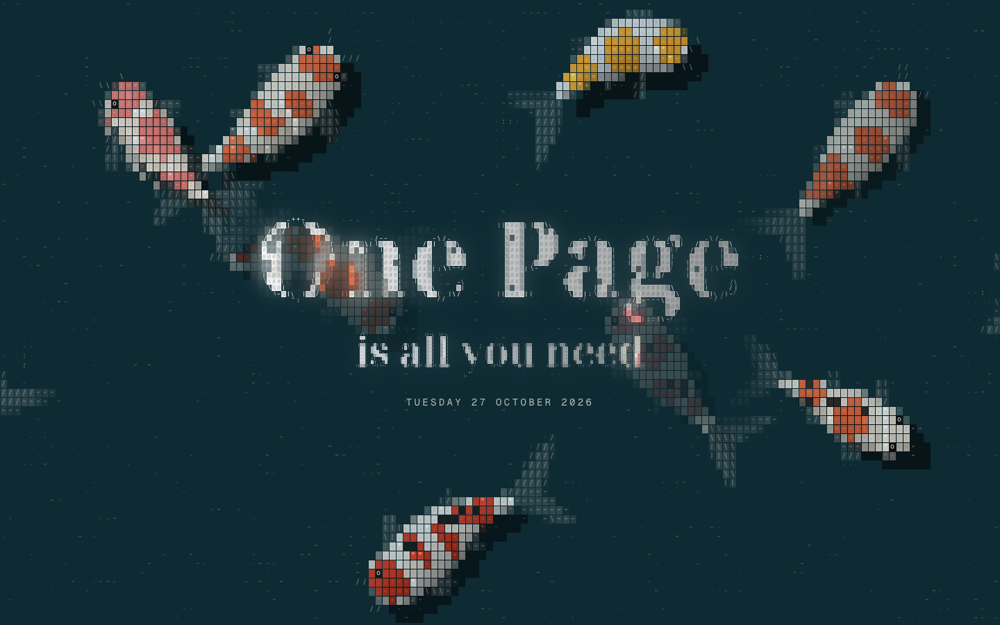
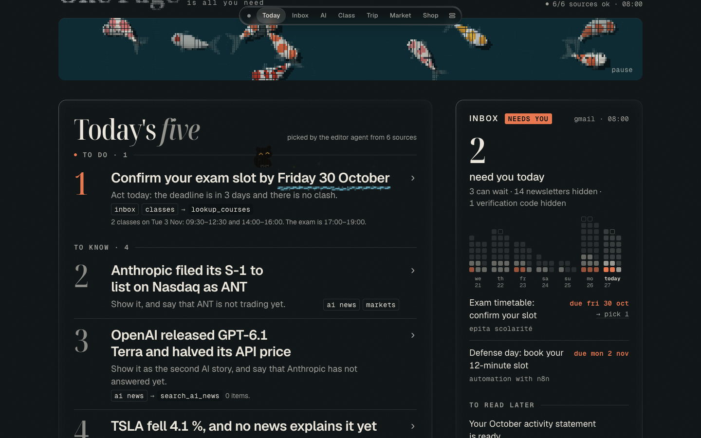

# One Page is all you need

**Every morning at 08:00, an n8n agent reads my seven sources and writes me one page.** Classes, inbox, AI news, a stock watchlist, deal prices and Christmas fares go in. Out comes a single page with the five things that matter today, each one traced back to where it came from. The page opens in a pond of ASCII koi, and a little black cat plays with the numbers.

<p align="center">
  
</p>

<p align="center">
  <a href="https://pursurer.github.io/one-page-is-all-you-need/"><b>▶ Open the demo page</b></a> &nbsp;·&nbsp;
  <a href="#how-it-works">How it works</a> &nbsp;·&nbsp;
  <a href="#run-it-yourself">Run it yourself</a>
</p>

This is my final project for the EPITA course *Automation with n8n* (2026). It is also where the [ASCII Koi](https://github.com/pursurer/ascii-koi) pond and the black cat began.

<p align="center">
  
</p>

## What is on the page

| Section | Source | What happens |
|---|---|---|
| **Today's five** | All of the below | The editor agent (Claude Haiku 5.5 in an n8n AI Agent node) picks the five items that matter today, splits them into *to do* and *to know*, and names the sources and tools behind each one |
| **Inbox** | Gmail, read-only | Sender and subject only, never the body. Promotions and social mail are only counted. One-time codes never reach the agent |
| **Classes** | Zeus timetable (ICS link) | The next 14 days, one row per day. The agent checks clashes with `lookup_courses` |
| **AI news** | [AIHOT](https://aihot.news) | Keyword match, and news already seen yesterday is left out. The agent can search more with `search_ai_news` |
| **Market** | Twelve Data; IBKR Flex | Daily candles for 8 watchlist codes, each placed against its 1-month high and low. IBKR positions are only counted: no code, quantity or amount goes further |
| **Shop** | SerpApi Google Shopping; Dealabs | The cheapest new offer for each watchlist item, compared with its own 7-day low (`get_price_history`) |
| **Trip** | SerpApi Google Flights and Hotels | Christmas fares from Paris for a few routes, with a price line per route |
| **Behind this page** | The run itself | Every source's status, the agent's tool calls, and a Rebuild button |

Chinese and French texts (news titles, mail subjects, deal titles) are translated to English by one model call, which is checked line by line; a bad translation keeps the original.

## How it works

Two workflows, joined by one JSON object, `EDITION`:

1. **Daily Page · 1 Build edition** runs at 08:00, or when the page's Rebuild button posts to `/webhook/rebuild`. It fetches every source, falls back to the cache for a source that failed twice (and marks it stale), translates, lets the editor agent pick, checks the answer against a schema, and saves the day's `EDITION` in an n8n Data Table. If the agent fails, yesterday's page stays: it never publishes an empty one.
2. **Daily Page · 2 Serve page** answers `GET /webhook/today`. It reads the latest `EDITION`, injects it into `page/template.html` between the `/*EDITION:BEGIN*/` and `/*EDITION:END*/` markers and returns the page. After 08:05 with no edition for today (the laptop was asleep at 08:00), it builds one first, at most once per 10 minutes.

The page is one HTML file with no build step. It can show any `EDITION`: missing sections, several stale sources, fewer than five picks, an empty inbox. Opened directly, it shows the demo edition stored inside it.

**The design.** The page opens on a full-screen ASCII koi pond with the title drawn in character cells. As you scroll, the pond shrinks into a band under the masthead. A black cat in character tiles trots to the number or keyword the agent marked and plays with it: good news hops, bad news sinks, a countdown flips. A yarn thread underlines the to-dos for a few seconds, then fades so it never gets in the way of reading.

**The demo edition.** The AI news is a real sample from 27 October 2026 and the deal prices are real Google Shopping prices from 1 November 2026. The classes, mail, watchlist prices and fares are mock data.

## What is in this repository

| Path | What it is |
|---|---|
| `page/template.html` | The page, with the demo edition inside |
| `page/edition.sample.json` | That demo edition as a file: the shape of `EDITION` |
| `workflow/` | `build.py` writes the workflow JSON from readable sources; Code node bodies are in `code/*.js`. See [workflow/README.md](workflow/README.md) |
| `newtab/` | A small Chrome extension that opens today's page on every new tab. See [newtab/README.md](newtab/README.md) |
| `compose.yaml` | n8n 2.43.8 in Docker, with `page/` mounted where n8n may read it |

## Run it yourself

You need Docker, Python 3, and your own accounts for the sources you want. A source with no credential stays off the canvas, and the page shows it as *not connected*.

1. Start n8n from this folder, then open http://localhost:5678 and create the owner account:

   ```bash
   docker compose up -d
   ```

2. In n8n, create the credentials you need: Anthropic, Google OAuth2 with the `gmail.readonly` scope, and HTTP Query Auth for IBKR Flex, Twelve Data and SerpApi. Put each credential's id into `CREDENTIALS` at the top of `workflow/build.py`. An id is not a secret: it only names a credential stored inside n8n.
3. Import `workflow/00-setup-tables.json` and run it once to create the Data Tables. Put their ids into `TABLE_IDS` in `build.py`.
4. In the `config` table, add the private settings: `zeus_ics_url` (your timetable's ICS link, which works like a password) and `ibkr_flex_query_id`.
5. Edit **My watchlist** in `build.py` (news keywords, deal targets, chart codes, routes), then build and deploy:

   ```bash
   cd workflow && python3 -I build.py
   ```

   ```bash
   ./deploy.sh 20-build.json 10-serve.json
   ```

   `deploy.sh` imports and publishes each workflow, restarts n8n once and waits a minute, because right after a restart n8n can still run the previous version.

6. Open http://localhost:5678/webhook/today, or load `newtab/` as an unpacked extension.

<!-- family:start -->
## The ASCII Koi family

Small things that share one look: koi drawn in text characters, letters that take a koi's colours as it swims under them, a black cat in character tiles, and black water (`#0d1315` water, `#ebe6dc` ink, `#e8784f` accent).

| Project | What it is |
|---|---|
| [ASCII Koi](https://github.com/pursurer/ascii-koi) | The pond itself: your new tab, under a clock made of the same characters. Its `pond.js` is the engine the others reuse |
| Codex Koi (coming soon) | The pond behind the Codex desktop app's new-chat page |
| [Claude Koi](https://github.com/pursurer/claude-koi) | The pond in a pane beside Claude Code, opened with `/koi` |
| [Codex ASCII Pets](https://github.com/pursurer/codex-ascii-pets) | The koi and the black cat as Codex pets |
| **One Page is all you need** (this repository) | Where the koi and the cat began: a one-page morning briefing that an n8n agent writes every day |

Every repository in the family has the topic [`ascii-koi`](https://github.com/topics/ascii-koi).
<!-- family:end -->

## License

MIT for the code in this repository. The AI news sample in the demo edition links to its original sources.
